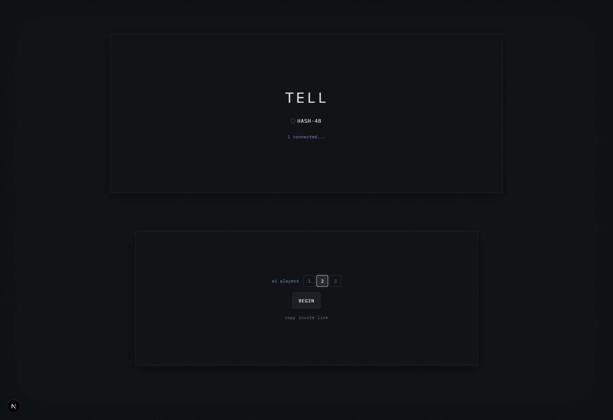

# Tell



Multiplayer social deduction game — reverse Turing test. Players join a group where some are AI, some human. Everyone votes each round on who sounds most human. After 5 rounds: big reveal, highest score wins.

## Prerequisites

- Python 3.12+
- [uv](https://docs.astral.sh/uv/) (Python package manager)
- Node.js 18+
- A Google API key (for Gemini AI players)

## Quick Start

```bash
cp .env.example .env
# Edit .env to add your GOOGLE_API_KEY

make dev
```

Backend starts on `http://localhost:8501`, frontend on `http://localhost:3500`. Dependencies install automatically.

Open the frontend. Click **play** to enter matchmaking (finds a game automatically), or **private game** to create a shareable link.

## Commands

Run `make` to see all targets.

| Command | Description |
|---|---|
| `make dev` | Start backend + frontend together |
| `make backend` | Start backend only |
| `make frontend` | Start frontend only |
| `make codegen` | Regenerate frontend types from backend OpenAPI |
| `make lint` | Lint + format Python |
| `make test` | Run all tests |
| `make clean` | Remove caches and build artifacts |

## Documentation

- [Architecture](docs/ARCHITECTURE.md) — real-time system, state machine, AI scheduling
- [Game Design](docs/GAME_DESIGN.md) — mechanics, prompts, design rationale

## License

© 2026 Nat Bishop. All rights reserved. This repository is published for portfolio
and evaluation purposes only; it is not licensed for reuse, redistribution, or
derivative works.
